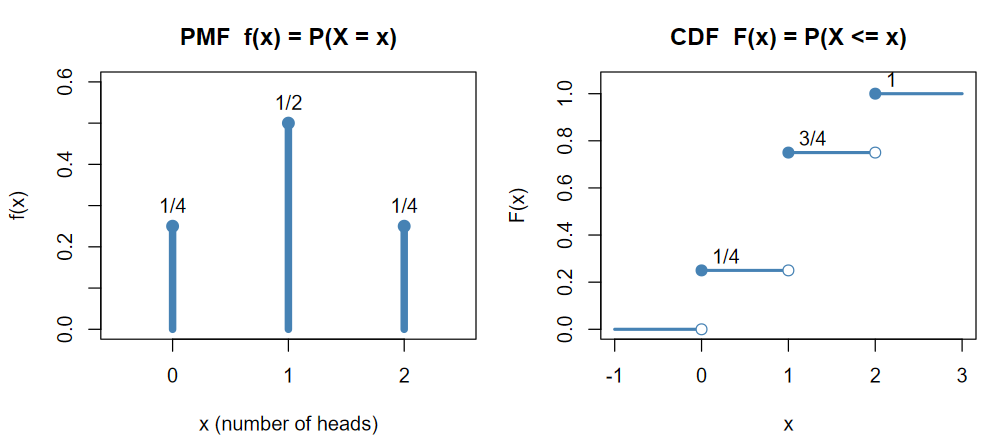
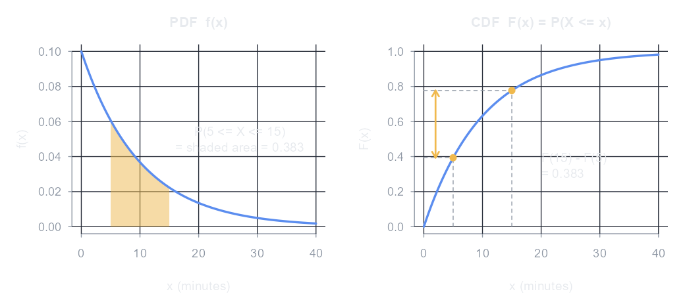
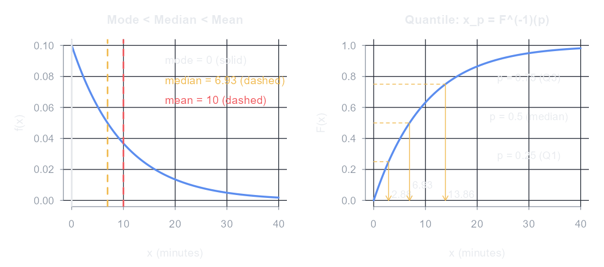
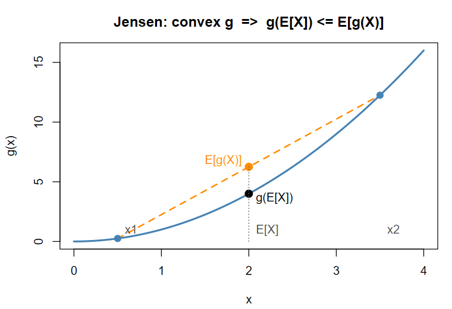

<!-- 第 3 章　隨機變數　(編輯說明請看 docs/CONTENT.md) -->

## 隨機變數的定義

### 定義

**隨機變數**(random variable)是一個**函數**：把樣本空間 $S$ 中的每個結果 $\omega$($\forall\, \omega \in S$)對應到一個實數，

$$
X : S \to \mathbb{R}, \qquad X(\omega) = x, \quad x \in \mathbb{R}
$$

它的名字裡有「變數」，本質卻是函數；「隨機」來自試驗結果 $\omega$ 事先無法確定。把結果轉成數字之後，就能計算平均、變異數等量數。

例：擲兩枚錢幣，$S = \{\text{正正}, \text{正反}, \text{反正}, \text{反反}\}$，令 $X$ = 正面的個數：

| 結果 $\omega$ | 正正 | 正反 | 反正 | 反反 |
|---|---|---|---|---|
| $X(\omega)$ | 2 | 1 | 1 | 0 |

「$X = 1$」其實是 $S$ 中的事件 $\{\omega : X(\omega) = 1\} = \{\text{正反}, \text{反正}\}$，所以隨機變數的機率由樣本空間上的機率決定：

$$
P(X = x) = P\left(\{\omega \in S : X(\omega) = x\}\right), \qquad P(X = 0) = \tfrac{1}{4},\quad P(X = 1) = \tfrac{1}{2},\quad P(X = 2) = \tfrac{1}{4}
$$

> **符號備註**：**大寫**英文字母 $X, Y, Z$ 代表**隨機變數本身**(還沒觀察、結果未定的那個函數)；**小寫** $x, y, z$ 代表隨機變數**實現**(realization)後的某個**特定值**。$P(X = x)$ 讀作「隨機變數 $X$ 取到特定值 $x$ 的機率」，例如 $X$ = 擲骰子的點數、$x = 3$ 時 $P(X = 3) = \tfrac{1}{6}$。同樣地，抽樣前的樣本 $X_1, \dots, X_n$ 是隨機變數，抽出來的資料 $x_1, \dots, x_n$ 是確定的數字。

### 值域

隨機變數所有可能取值的集合稱為**值域**(range)，記為

$$
R_X = \{\, X(\omega) : \forall, \omega \in S \,\} \subseteq \mathbb{R}
$$

| 隨機變數 | 值域 $R_X$ | 類型 |
|---|---|---|
| 擲兩枚錢幣的正面數 | $\{0, 1, 2\}$ | 離散(有限個) |
| 擲錢幣直到第一次正面所需的次數 | $\{1, 2, 3, \dots\}$ | 離散(可數無限多個) |
| 明天台股加權指數的報酬率 | 一個區間 | 連續 |

依值域分類：值域是**有限個或可數無限多個**點的是**離散型**隨機變數；值域是**一個或多個區間**(不可數)的是**連續型**隨機變數。

### 隨機變數的函數仍是隨機變數

若 $X$ 是隨機變數、$g$ 是一個實數函數，則 $Y = g(X)$ 也是隨機變數，因為它仍然是把每個結果對應到一個實數：

$$
Y(\omega) = g\big(X(\omega)\big), \qquad \omega \in S
$$

$Y$ 的機率分配由 $X$ 的分配決定：把所有會變成 $y$ 的 $x$ 的機率加起來，

$$
P(Y = y) = P\big(g(X) = y\big) = \sum_{x \,:\, g(x) = y} P(X = x)
$$

延續擲兩枚錢幣的例子：

- **一對一**：每出現一次正面賺 1 元、反面賠 1 元，淨賺 $Y = X - (2 - X) = 2X - 2$，值域 $\{-2, 0, 2\}$，機率依序是 $\tfrac{1}{4}, \tfrac{1}{2}, \tfrac{1}{4}$，和 $X$ 一一對應。
- **多對一**：$W = (X - 1)^2$，$X = 0$ 和 $X = 2$ 都變成 $W = 1$，所以 $P(W = 1) = \tfrac{1}{4} + \tfrac{1}{4} = \tfrac{1}{2}$、$P(W = 0) = \tfrac{1}{2}$，值域縮小成 $\{0, 1\}$，機率要合併。

同樣地，好幾個隨機變數的函數也是隨機變數，例如 $X + Y$、$XY$，以及樣本平均數 $\bar{X} = \frac{1}{n}\sum X_i$——這就是第 6 章「抽樣分配」要研究 $\bar{X}$ 的分配的原因。

> **金融例子**：明天的報酬率 $R$ 是隨機變數，投入 100 萬的損益 $100R$(萬元)、帳戶市值 $100(1 + R)$ 都是 $R$ 的函數，也都是隨機變數。

## 離散型與連續型

|  | 離散型 | 連續型 |
|---|---|---|
| 描述 | 機率質量函數(PMF) $f(x) = P(X = x)$ | 機率密度函數(PDF) $f(x)$，$P(a \le X \le b) = \int_a^b f(x)\,dx$ |
| 條件 | $f(x) \ge 0$，$\sum_x f(x) = 1$ | $f(x) \ge 0$，$\int_{-\infty}^{\infty} f(x)\,dx = 1$ |
| 單點機率 | 可以大於 0 | $P(X = a) = 0$，所以 $\le$ 與 $<$ 沒有差別 |

**累積分配函數**(cumulative distribution function，CDF)對兩種類型都適用：

$$
F(x) = P(X \le x), \qquad \lim_{x \to -\infty} F(x) = 0,\quad \lim_{x \to \infty} F(x) = 1,\quad F \text{ 遞增且右連續}
$$

$$
P(a < X \le b) = F(b) - F(a)
$$

### 離散型：PMF 與 CDF

延續擲兩枚錢幣的正面數 $X$：

- **PMF**(左)：在每個可能值 $x$ 上畫一根長條，高度就是機率 $f(x) = P(X = x)$，所有長條的高度加起來是 1。
- **CDF**(右)：是**階梯函數**，$F(x) = \sum_{t \le x} f(t)$。在每個可能值處往上**跳一階，跳的高度就是該點的機率**($F$ 在 0、1、2 分別跳 $\tfrac{1}{4}$、$\tfrac{1}{2}$、$\tfrac{1}{4}$)，兩個可能值之間保持水平。
- 跳點的**實心點**表示 $F$ 在那裡取上面的值，**空心點**表示取不到：例如 $F(1) = P(X \le 1) = \tfrac{3}{4}$，但 $x$ 稍微小於 1 時 $F(x) = \tfrac{1}{4}$，這就是「右連續」。

$$
F(x) = \begin{cases} 0, & x < 0 \\ \tfrac{1}{4}, & 0 \le x < 1 \\ \tfrac{3}{4}, & 1 \le x < 2 \\ 1, & x \ge 2 \end{cases}
$$

### 連續型：PDF 與 CDF

等公車的時間 $X$(分鐘)，假設平均 10 分鐘、服從指數分配(第 5 章)：$f(x) = \tfrac{1}{10}e^{-x/10}$，$F(x) = 1 - e^{-x/10}$，$x \ge 0$。

- **PDF**(左)：曲線的**高度不是機率**(可以大於 1)，曲線下的**面積才是機率**。等 5 到 15 分鐘的機率就是橘色面積：

$$
P(5 \le X \le 15) = \int_{5}^{15} \frac{1}{10} e^{-x/10}\,dx = e^{-0.5} - e^{-1.5} \approx 0.383
$$

- **CDF**(右)：是一條**連續、遞增的曲線**，$F(x) = \int_{-\infty}^{x} f(t)\,dt$ 是 PDF 從左邊累積到 $x$ 的面積；反過來 PDF 是 CDF 的斜率，$f(x) = F'(x)$。同一個機率在 CDF 上是兩點的**高度差**：$F(15) - F(5) \approx 0.777 - 0.393 = 0.383$。
- 單點的面積是 0，所以連續型 $P(X = 5) = 0$，$P(5 \le X \le 15)$ 與 $P(5 < X < 15)$ 相同。

## 期望值

**期望值**(expected value，平均數)是隨機變數以機率加權的平均，代表「重複很多次的長期平均」：

$$
E(X) = \mu = \begin{cases} \displaystyle\sum_x x\,f(x) & \text{離散} \\[10pt] \displaystyle\int_{-\infty}^{\infty} x\,f(x)\,dx & \text{連續} \end{cases}
\qquad\qquad
E[g(X)] = \begin{cases} \displaystyle\sum_x g(x)\,f(x) \\[10pt] \displaystyle\int_{-\infty}^{\infty} g(x)\,f(x)\,dx \end{cases}
$$

- 擲兩枚錢幣的正面數：$E(X) = 0 \cdot \tfrac{1}{4} + 1 \cdot \tfrac{1}{2} + 2 \cdot \tfrac{1}{4} = 1$。
- 擲一顆公平骰子：$E(X) = \tfrac{1 + 2 + \cdots + 6}{6} = 3.5$。期望值是「長期平均」，不代表單次會擲出 3.5。
- 等公車時間(指數分配，第 5 章)：$E(X) = \int_0^\infty x \cdot \tfrac{1}{10}e^{-x/10}\,dx = 10$ 分鐘。

> **金融用語**：一筆交易的「期望報酬」= 勝率 × 平均賺 − 敗率 × 平均賠。勝率高不代表期望值為正，賺小賠大的策略勝率 80% 也可能長期虧錢。

## 變異數與標準差

**變異數**(variance)是「離平均數多遠」的平方的期望值，衡量分散程度；**標準差**(standard deviation)是變異數的正平方根，單位與 $X$ 相同，較容易解讀：

$$
\operatorname{Var}(X) = \sigma^2 = E\left[(X - \mu)^2\right] = \begin{cases} \displaystyle\sum_x (x - \mu)^2 f(x) & \text{離散} \\[10pt] \displaystyle\int_{-\infty}^{\infty} (x - \mu)^2 f(x)\,dx & \text{連續} \end{cases}
$$

$$
\operatorname{SD}(X) = \sigma = \sqrt{\operatorname{Var}(X)} = \sqrt{E\left[(X - \mu)^2\right]}
$$

實際計算多用**簡便公式**(展開平方、用下一節的期望值性質)：

$$
\operatorname{Var}(X) = E\left[X^2 - 2\mu X + \mu^2\right] = E(X^2) - 2\mu E(X) + \mu^2 = E(X^2) - \left[E(X)\right]^2
$$

- 擲兩枚錢幣：$E(X^2) = 0 \cdot \tfrac{1}{4} + 1 \cdot \tfrac{1}{2} + 4 \cdot \tfrac{1}{4} = \tfrac{3}{2}$，$\operatorname{Var}(X) = \tfrac{3}{2} - 1^2 = \tfrac{1}{2}$，$\sigma = \sqrt{1/2} \approx 0.707$。
- 擲一顆公平骰子：$E(X^2) = \tfrac{91}{6}$，$\operatorname{Var}(X) = \tfrac{91}{6} - 3.5^2 = \tfrac{35}{12} \approx 2.92$，$\sigma \approx 1.71$。
- 等公車時間：$\operatorname{Var}(X) = 100$，$\sigma = 10$ 分鐘(指數分配的標準差等於平均數)。

## 期望值、變異數、標準差的運算性質

以下 $a, b, c$ 為常數，$X, Y$ 為隨機變數。

### 期望值

| 性質 | 公式 | 說明 |
|---|---|---|
| 常數 | $E(c) = c$ | 常數的平均就是自己 |
| 線性 | $E(aX + b) = a\,E(X) + b$ | 先平移縮放再平均 = 先平均再平移縮放 |
| 相加 | $E(X + Y) = E(X) + E(Y)$ | **不需要獨立**，任何兩個隨機變數都成立 |
| 推廣 | $E\left(\sum_{i} a_i X_i\right) = \sum_{i} a_i\,E(X_i)$ | 線性組合的期望值 |
| 相乘 | $E(XY) = E(X)\,E(Y)$ | **只有 $X$、$Y$ 獨立時**才成立 |

證明(離散)：$E(aX + b) = \sum_x (ax + b) f(x) = a\sum_x x f(x) + b\sum_x f(x) = a\,E(X) + b$。

> **注意**：一般而言 $E[g(X)] \ne g\big(E(X)\big)$，例如 $E(X^2) \ne [E(X)]^2$、$E\left(\tfrac{1}{X}\right) \ne \tfrac{1}{E(X)}$。只有 $g$ 是直線時才相等，凸函數時的大小關係見本章最後的 Jensen 不等式。

### 變異數

| 性質 | 公式 | 說明 |
|---|---|---|
| 常數 | $\operatorname{Var}(c) = 0$ | 常數沒有變動 |
| 平移 | $\operatorname{Var}(X + b) = \operatorname{Var}(X)$ | 整體平移，分散程度不變 |
| 縮放 | $\operatorname{Var}(aX) = a^2 \operatorname{Var}(X)$ | 單位放大 $a$ 倍，變異數放大 $a^2$ 倍 |
| 合併 | $\operatorname{Var}(aX + b) = a^2 \operatorname{Var}(X)$ | |
| 非負 | $\operatorname{Var}(X) \ge 0$ | 等號只在 $X$ 為常數時成立 |
| 相加 | $\operatorname{Var}(X \pm Y) = \operatorname{Var}(X) + \operatorname{Var}(Y) \pm 2\operatorname{Cov}(X, Y)$ | 共變異數 $\operatorname{Cov}$ 見第 4 章 |
| 獨立相加 | $\operatorname{Var}(X \pm Y) = \operatorname{Var}(X) + \operatorname{Var}(Y)$ | **相減也是相加**：兩邊的不確定性都會累積 |
| 獨立同分配 | $\operatorname{Var}\left(\sum_{i=1}^{n} X_i\right) = n\sigma^2$，$\operatorname{Var}(\bar{X}) = \dfrac{\sigma^2}{n}$ | 平均越多次，越穩定 |

證明：令 $\mu = E(X)$，則 $E(aX + b) = a\mu + b$，

$$
\operatorname{Var}(aX + b) = E\left[(aX + b - a\mu - b)^2\right] = E\left[a^2 (X - \mu)^2\right] = a^2 \operatorname{Var}(X)
$$

### 標準差

| 性質 | 公式 | 說明 |
|---|---|---|
| 平移縮放 | $\operatorname{SD}(aX + b) = \lvert a \rvert\,\operatorname{SD}(X)$ | 取絕對值，標準差不會是負的 |
| 獨立相加 | $\operatorname{SD}(X \pm Y) = \sqrt{\operatorname{SD}(X)^2 + \operatorname{SD}(Y)^2}$ | 標準差**不能直接相加**，要先平方相加再開根號 |
| 一般相加 | $\operatorname{SD}(X + Y) \le \operatorname{SD}(X) + \operatorname{SD}(Y)$ | 等號只在完全正相關時成立(分散風險的原理，第 4 章) |
| 獨立同分配 | $\operatorname{SD}(\bar{X}) = \dfrac{\sigma}{\sqrt{n}}$ | 標準誤(第 6 章) |

**例：延續擲兩枚錢幣**，每出現一次正面賺 1 元、反面賠 1 元，淨賺 $Y = 2X - 2$。不必重新列分配，直接用性質：

$$
E(Y) = 2E(X) - 2 = 2(1) - 2 = 0, \qquad \operatorname{Var}(Y) = 2^2 \operatorname{Var}(X) = 4 \cdot \tfrac{1}{2} = 2, \qquad \operatorname{SD}(Y) = 2 \cdot 0.707 \approx 1.414
$$

(直接用 $Y$ 的分配 $\{-2, 0, 2\}$、機率 $\tfrac{1}{4}, \tfrac{1}{2}, \tfrac{1}{4}$ 計算，結果相同。)

**標準化**：令 $Z = \dfrac{X - \mu}{\sigma} = \dfrac{1}{\sigma}X - \dfrac{\mu}{\sigma}$，由線性性質

$$
E(Z) = \frac{1}{\sigma}E(X) - \frac{\mu}{\sigma} = 0, \qquad \operatorname{Var}(Z) = \frac{1}{\sigma^2}\operatorname{Var}(X) = 1
$$

這就是第 1 章 $Z$ 分數平均為 0、標準差為 1 的原因，也是第 5 章把常態分配轉成標準常態的方法。

> **金融：年化波動度**。若每日報酬 $R_1, \dots, R_{252}$ 獨立且標準差都是 $\sigma_d$，一年的報酬約為它們的和，由獨立相加的性質 $\operatorname{Var}\left(\sum R_i\right) = 252\,\sigma_d^2$，所以年化標準差 $= \sigma_d\sqrt{252}$(不是 $252\,\sigma_d$)。日波動 1.3% 換算成年化約 $1.3\% \times \sqrt{252} \approx 20.6\%$。

## 中位數、眾數、分位數

期望值與變異數之外，隨機變數也有「位置」的量數。第 1 章的中位數、眾數、分位數是從**樣本資料**算的；這裡是由**機率分配**(PMF、PDF、CDF)定義的母體版本。

### 中位數

$m$ 是 $X$ 的**中位數**(median)，若 $X$ 落在 $m$ 兩側的機率都至少一半：

$$
P(X \le m) \ge \frac{1}{2} \quad \text{且} \quad P(X \ge m) \ge \frac{1}{2}
$$

連續型時就是解 $F(m) = \dfrac{1}{2}$，也就是把 PDF 下的面積左右各分一半。

- **離散**：擲兩枚錢幣的正面數，$P(X \le 1) = \tfrac{3}{4}$、$P(X \ge 1) = \tfrac{3}{4}$，中位數 $m = 1$。
- **連續**：等公車時間，$F(m) = 1 - e^{-m/10} = \tfrac{1}{2}$，得 $m = 10 \ln 2 \approx 6.93$ 分鐘：一半的人等不到 7 分鐘。
- **可能不唯一**：擲一枚錢幣，$X$ 為正面數($0$ 或 $1$ 各 $\tfrac{1}{2}$)，$[0, 1]$ 之間的每個數都滿足定義，習慣上取中點 $0.5$。

### 眾數

**眾數**(mode)是機率最大(離散)或密度最高(連續)的值，也就是 PMF 或 PDF 的最高點：

$$
\text{mode} = \underset{x}{\arg\max}\; f(x)
$$

- 擲兩枚錢幣：$f(1) = \tfrac{1}{2}$ 最大，眾數為 1。
- 等公車時間：PDF 從 $x = 0$ 開始一路遞減，眾數為 0。
- 眾數可能不唯一，例如均勻分配每個值的密度都相同，雙峰分配有兩個眾數。

### 分位數

**第 $p$ 分位數**(quantile)$x_p$ 是讓「小於等於它的機率」達到 $p$ 的值，也就是 CDF 的**反函數**：

$$
x_p = F^{-1}(p) = \min\{\, x : F(x) \ge p \,\}, \qquad 0 < p < 1
$$

連續型時直接解 $F(x_p) = p$；離散型的 CDF 是階梯，不一定剛好等於 $p$，所以取「第一個讓 $F(x) \ge p$ 的 $x$」。常用的特例：

$$
Q_1 = x_{0.25}, \qquad \text{中位數} = x_{0.5}, \qquad Q_3 = x_{0.75}, \qquad \text{第 } k \text{ 百分位數} = x_{k/100}
$$

- **連續**：等公車時間 $x_p = -10 \ln(1 - p)$，所以 $Q_1 = 10 \ln \tfrac{4}{3} \approx 2.88$、中位數 $\approx 6.93$、$Q_3 = 10 \ln 4 \approx 13.86$、第 90 百分位數 $= 10 \ln 10 \approx 23.03$ 分鐘：只有 10% 的人要等超過 23 分鐘。
- **離散**：擲兩枚錢幣，$F(0) = \tfrac{1}{4}$、$F(1) = \tfrac{3}{4}$，所以 $x_{0.25} = 0$、$x_{0.5} = 1$、$x_{0.75} = 1$。

**三者的關係**：等公車時間右偏(右尾很長)，眾數 0 < 中位數 6.93 < 平均數 10，與第 1 章「右偏時平均數 > 中位數 > 眾數」一致；平均數被少數等很久的人拉高，中位數較能代表「一般人」的等待時間。

> **金融：風險值**(Value at Risk，VaR)就是分位數。若明天報酬率的第 5 百分位數是 $-2.1\%$，代表「有 95% 的把握，明天虧損不會超過 2.1%」，稱 95% 信心水準的 1 日 VaR 為 2.1%。

## 動差與動差生成函數

$$
\mu_k' = E(X^k)\ (\text{k 階原動差}), \qquad
\mu_k = E\left[(X - \mu)^k\right]\ (\text{k 階主動差}), \qquad
M_X(t) = E\left(e^{tX}\right), \quad E(X^k) = M_X^{(k)}(0)
$$

- 二階主動差是變異數；三階、四階主動差標準化後就是偏態係數與峰態係數(第 1 章)。
- 動差生成函數(MGF)唯一決定分配：兩個隨機變數的 MGF 相同，分配就相同。常用來證明獨立隨機變數相加後的分配。

## 機率不等式

很多時候我們不知道隨機變數確切的分配，只知道平均數或變異數。機率不等式在**不假設分配形狀**的情況下，給出機率或期望值的上下界。

### Markov 不等式

若 $X \ge 0$(非負的隨機變數)，對任意 $a > 0$：

$$
P(X \ge a) \le \frac{E(X)}{a}
$$

**證明**：令 $I = \mathbf{1}\{X \ge a\}$(事件 $X \ge a$ 發生時為 1，否則為 0)。因為 $X \ge 0$，恆有 $X \ge a \cdot I$，兩邊取期望值得 $E(X) \ge a\,E(I) = a\,P(X \ge a)$。

- **意義**：非負的量，超過平均數 $k$ 倍的機率不會大於 $\tfrac{1}{k}$。例如平均所得為 5 萬，所得超過 25 萬的人不會超過 $\tfrac{5}{25} = 20\%$。
- 例：等公車平均 10 分鐘，不論分配為何，$P(X \ge 30) \le \tfrac{10}{30} = \tfrac{1}{3}$。若真的是指數分配，實際值 $e^{-3} \approx 5\%$：Markov 不等式只用到平均數，所以界限很寬鬆，但它**對所有非負分配都成立**。

### Chebyshev 不等式

對任意平均數 $\mu$、標準差 $\sigma$ 有限的隨機變數，及任意 $k > 0$：

$$
P\left(|X - \mu| \ge k\sigma\right) \le \frac{1}{k^2}
\qquad\Longleftrightarrow\qquad
P\left(|X - \mu| < k\sigma\right) \ge 1 - \frac{1}{k^2}
$$

**證明**：把 Markov 不等式用在非負的 $(X - \mu)^2$、取 $a = k^2\sigma^2$：

$$
P\left(|X - \mu| \ge k\sigma\right) = P\left((X - \mu)^2 \ge k^2\sigma^2\right) \le \frac{E\left[(X - \mu)^2\right]}{k^2\sigma^2} = \frac{\sigma^2}{k^2\sigma^2} = \frac{1}{k^2}
$$

- **意義**：任何分配，資料離平均數越遠越少見，而且有量化的保證。第 1 章的柴比雪夫定理就是這個不等式用在樣本上的版本。
- 與常態分配比較(落在 $\mu \pm k\sigma$ 內的比例)：

| $k$ | 1.5 | 2 | 3 |
|---|---|---|---|
| Chebyshev 保證至少 | 55.6% | 75% | 88.9% |
| 常態分配實際 | 86.6% | 95.4% | 99.7% |

- 例：等公車 $\mu = \sigma = 10$(指數分配)，$P(X \ge 30) = P(X - 10 \ge 2\sigma) \le P(|X - \mu| \ge 2\sigma) \le \tfrac{1}{4}$，比 Markov 的 $\tfrac{1}{3}$ 緊，因為多用了變異數的資訊。
- **金融**：日報酬的分配通常有肥尾(第 1 章)，用常態估計「3 個標準差以外的機率只有 0.3%」會低估風險；Chebyshev 給的是**不論分配**都成立的上限 $\tfrac{1}{9} \approx 11\%$。

### Jensen 不等式

若 $g$ 是**凸函數**(convex，圖形向上彎，例如 $x^2$、$e^x$、$\tfrac{1}{x}$($x > 0$))，則

$$
g\big(E(X)\big) \le E\big[g(X)\big]
$$

若 $g$ 是**凹函數**(concave，向下彎，例如 $\ln x$、$\sqrt{x}$)，不等號反向：$g\big(E(X)\big) \ge E\big[g(X)\big]$。等號成立的條件是 $X$ 為常數(或 $g$ 是直線)。

**直覺**：$X$ 以各一半的機率取 $x_1$、$x_2$。$E[g(X)]$ 是曲線上兩點的平均，落在兩點連線(弦)的中點；$g(E[X])$ 是先平均再代入，落在曲線上。凸函數的弦永遠在曲線上方，所以 $E[g(X)] \ge g(E[X])$。

- **變異數非負**：取 $g(x) = x^2$，$E(X^2) \ge [E(X)]^2$，也就是 $\operatorname{Var}(X) = E(X^2) - [E(X)]^2 \ge 0$。
- **算術平均 ≥ 幾何平均**：取凹函數 $\ln$，$E(\ln X) \le \ln E(X)$。$X$ 等機率取 $x_1, \dots, x_n$(皆為正)時，就是

$$
\sqrt[n]{x_1 x_2 \cdots x_n} \le \frac{x_1 + x_2 + \cdots + x_n}{n}
$$

- **注意**：$E\left(\tfrac{1}{X}\right) \ne \tfrac{1}{E(X)}$。例如本益比的平均，不等於平均盈餘殖利率的倒數。

> **金融：波動拖累**(volatility drag)。每期報酬 $R$ 有一半機率 $+50\%$、一半機率 $-50\%$，算術平均報酬 $E(R) = 0$，但長期複利成長看的是 $E[\ln(1 + R)] = \tfrac{1}{2}(\ln 1.5 + \ln 0.5) = \tfrac{1}{2}\ln 0.75 < 0$ —— 由 Jensen 不等式，$E[\ln(1+R)] \le \ln E(1 + R) = 0$，波動越大差距越大，近似為 $E[\ln(1+R)] \approx \mu - \tfrac{\sigma^2}{2}$。所以平均報酬為 0 的投資，長期下來會虧損(每期幾何平均 $\sqrt{0.75} - 1 \approx -13.4\%$)。
