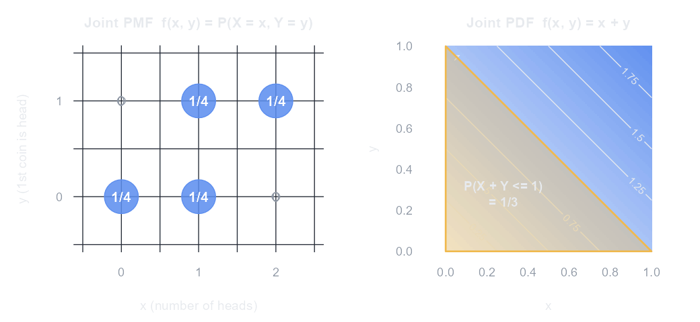

<!-- 第 4 章　多元隨機變數　(編輯說明請看 docs/CONTENT.md) -->

同時研究兩個(以上)隨機變數時，除了各自的分配，更重要的是它們**之間的關係**：一起變大、一個變大另一個變小，還是毫無關聯。把兩個隨機變數一起描述的分配稱為**聯合分配**(joint distribution)。

## 二元離散型隨機變數

### 聯合機率質量函數

$X$、$Y$ 都是離散型時，**聯合 PMF** 給出每一組 $(x, y)$ 同時發生的機率：

$$
f(x, y) = P(X = x,\ Y = y), \qquad f(x, y) \ge 0, \qquad \sum_{x}\sum_{y} f(x, y) = 1
$$

任一事件的機率就是把落在其中的格子加起來：$P\big((X, Y) \in A\big) = \sum\sum_{(x, y) \in A} f(x, y)$。

例：擲兩枚公正錢幣，令 $X$ = 正面的個數、$Y$ = 第一枚是否為正面(是 = 1，否 = 0)。四種結果各 $\tfrac{1}{4}$：正正 $(2, 1)$、正反 $(1, 1)$、反正 $(1, 0)$、反反 $(0, 0)$，整理成**聯合機率表**：

| $Y$ ＼ $X$ | 0 | 1 | 2 | $f_Y(y)$ |
|---|---|---|---|---|
| 0 | 1/4 | 1/4 | 0 | 1/2 |
| 1 | 0 | 1/4 | 1/4 | 1/2 |
| $f_X(x)$ | 1/4 | 1/2 | 1/4 | 1 |

### 邊際分配

只看其中一個變數的分配，把另一個變數「加總掉」，就是表格的列合計與欄合計：

$$
f_X(x) = \sum_{y} f(x, y), \qquad f_Y(y) = \sum_{x} f(x, y)
$$

上表最下列 $f_X = \left(\tfrac{1}{4}, \tfrac{1}{2}, \tfrac{1}{4}\right)$ 就是第 3 章「定義」裡的正面數分配；最右欄 $f_Y = \left(\tfrac{1}{2}, \tfrac{1}{2}\right)$。

### 條件分配

已知 $Y = y$ 時 $X$ 的分配(只看那一列，再除以該列合計)：

$$
f(x \mid y) = P(X = x \mid Y = y) = \frac{f(x, y)}{f_Y(y)}, \qquad f_Y(y) > 0
$$

例：已知第一枚是正面($Y = 1$)，$f(1 \mid 1) = \dfrac{1/4}{1/2} = \dfrac{1}{2}$、$f(2 \mid 1) = \dfrac{1}{2}$、$f(0 \mid 1) = 0$：正面數只可能是 1 或 2。

### 獨立

$X$、$Y$ **獨立**若且唯若**每一格**都等於邊際機率的乘積：

$$
f(x, y) = f_X(x)\,f_Y(y) \qquad \text{對所有 } x, y
$$

只要有一格不成立就不獨立。上例 $f(0, 1) = 0 \ne f_X(0)\,f_Y(1) = \tfrac{1}{4} \times \tfrac{1}{2}$，所以 $X$、$Y$ 不獨立——第一枚是正面，總正面數自然比較可能多。

## 二元連續型隨機變數

### 聯合機率密度函數

$X$、$Y$ 都是連續型時，**聯合 PDF** $f(x, y)$ 是一張曲面，機率是曲面下的**體積**(二重積分)：

$$
P\big((X, Y) \in A\big) = \iint_{A} f(x, y)\,dx\,dy, \qquad f(x, y) \ge 0, \qquad \int_{-\infty}^{\infty}\int_{-\infty}^{\infty} f(x, y)\,dx\,dy = 1
$$

例：$f(x, y) = x + y$，$0 \le x \le 1$、$0 \le y \le 1$(其他地方為 0)。先確認總體積為 1：

$$
\int_0^1\!\!\int_0^1 (x + y)\,dy\,dx = \int_0^1 \left(x + \tfrac{1}{2}\right) dx = \tfrac{1}{2} + \tfrac{1}{2} = 1
$$

$X + Y \le 1$ 的機率(上圖橘色三角形)：

$$
P(X + Y \le 1) = \int_0^1\!\!\int_0^{1 - x} (x + y)\,dy\,dx = \int_0^1 \left(\tfrac{1}{2} - \tfrac{x^2}{2}\right) dx = \tfrac{1}{3}
$$

### 邊際分配與條件分配

把另一個變數「積分掉」得到邊際 PDF；給定 $Y = y$ 時 $X$ 的條件 PDF 是聯合 PDF 除以 $Y$ 的邊際 PDF：

$$
f_X(x) = \int_{-\infty}^{\infty} f(x, y)\,dy, \qquad f_Y(y) = \int_{-\infty}^{\infty} f(x, y)\,dx, \qquad f(x \mid y) = \frac{f(x, y)}{f_Y(y)}, \quad f_Y(y) > 0
$$

- 例：$f_X(x) = \int_0^1 (x + y)\,dy = x + \tfrac{1}{2}$，同理 $f_Y(y) = y + \tfrac{1}{2}$。
- 條件 PDF：$f(x \mid y) = \dfrac{x + y}{y + 1/2}$，$0 \le x \le 1$。給定 $Y = \tfrac{1}{2}$ 時，$P\left(X \le \tfrac{1}{2} \,\middle|\, Y = \tfrac{1}{2}\right) = \int_0^{1/2} \dfrac{x + 1/2}{1}\,dx = \tfrac{3}{8}$。

### 獨立

$X$、$Y$ 獨立若且唯若 $f(x, y) = f_X(x)\,f_Y(y)$ 對所有 $x, y$ 成立。上例 $(x + \tfrac{1}{2})(y + \tfrac{1}{2}) \ne x + y$，所以不獨立。

| | 二元離散型 | 二元連續型 |
|---|---|---|
| 聯合分配 | $f(x, y) = P(X = x, Y = y)$ | $f(x, y)$，機率 = 二重積分(體積) |
| 總和為 1 | $\sum_x \sum_y f(x, y) = 1$ | $\iint f(x, y)\,dx\,dy = 1$ |
| 邊際分配 | $f_X(x) = \sum_y f(x, y)$ | $f_X(x) = \int f(x, y)\,dy$ |
| 條件分配 | $f(x \mid y) = f(x, y) / f_Y(y)$ | $f(x \mid y) = f(x, y) / f_Y(y)$ |
| 獨立 | $f(x, y) = f_X(x)\,f_Y(y)$ | $f(x, y) = f_X(x)\,f_Y(y)$ |

## 條件期望值與條件變異數

### 函數的期望值

$X$、$Y$ 的任何函數 $g(X, Y)$ 都是隨機變數(第 3 章「隨機變數的函數仍是隨機變數」)，它的期望值用聯合分配加權：

$$
E\big[g(X, Y)\big] = \begin{cases} \displaystyle\sum_{x}\sum_{y} g(x, y)\,f(x, y) & \text{離散} \\[12pt] \displaystyle\int_{-\infty}^{\infty}\int_{-\infty}^{\infty} g(x, y)\,f(x, y)\,dx\,dy & \text{連續} \end{cases}
$$

由此可得兩個最常用的性質：

$$
E(aX + bY + c) = a\,E(X) + b\,E(Y) + c\quad(\text{不需要獨立}), \qquad
E(XY) = E(X)\,E(Y)\quad(X, Y \text{ 獨立時})
$$

證明(離散)：$E(X + Y) = \sum\sum (x + y) f(x, y) = \sum_x x \sum_y f(x, y) + \sum_y y \sum_x f(x, y) = \sum_x x f_X(x) + \sum_y y f_Y(y) = E(X) + E(Y)$。

### 共變異數與相關係數

**共變異數**(covariance)衡量兩個變數「一起變動」的方向；**相關係數**(correlation)把它標準化到 $-1$ 到 $1$ 之間：

$$
\operatorname{Cov}(X, Y) = E\big[(X - \mu_X)(Y - \mu_Y)\big] = E(XY) - E(X)\,E(Y), \qquad
\rho = \frac{\operatorname{Cov}(X, Y)}{\sigma_X\,\sigma_Y}, \quad -1 \le \rho \le 1
$$

- $\operatorname{Cov} > 0$：一個高於平均時，另一個也傾向高於平均(正相關)；$\operatorname{Cov} < 0$ 則反之。$|\rho| = 1$ 代表完全線性關係。
- $\operatorname{Cov}(X, X) = \operatorname{Var}(X)$；$\operatorname{Cov}(aX + b,\ cY + d) = ac\,\operatorname{Cov}(X, Y)$；$\rho$ 不受單位影響($a$、$c$ 同號時不變)。
- 獨立 $\Rightarrow \operatorname{Cov} = 0$；但 **$\operatorname{Cov} = 0$ 不一定獨立**(只代表沒有「線性」關係)。例外：二元常態時兩者等價。

**兩個例子算一遍**：

| | 擲兩枚錢幣(離散) | $f(x, y) = x + y$(連續) |
|---|---|---|
| $E(X)$、$E(Y)$ | $1$、$\tfrac{1}{2}$ | $\tfrac{7}{12}$、$\tfrac{7}{12}$ |
| $E(XY)$ | $1 \cdot 1 \cdot \tfrac{1}{4} + 2 \cdot 1 \cdot \tfrac{1}{4} = \tfrac{3}{4}$ | $\iint xy(x + y)\,dx\,dy = \tfrac{1}{3}$ |
| $\operatorname{Cov}(X, Y)$ | $\tfrac{3}{4} - 1 \cdot \tfrac{1}{2} = \tfrac{1}{4}$ | $\tfrac{1}{3} - \left(\tfrac{7}{12}\right)^2 = -\tfrac{1}{144}$ |
| $\operatorname{Var}(X)$、$\operatorname{Var}(Y)$ | $\tfrac{1}{2}$、$\tfrac{1}{4}$ | $\tfrac{11}{144}$、$\tfrac{11}{144}$ |
| $\rho$ | $\dfrac{1/4}{\sqrt{1/2 \cdot 1/4}} \approx 0.71$(正相關) | $\dfrac{-1/144}{11/144} = -\tfrac{1}{11} \approx -0.09$(微弱負相關) |

### 線性組合的期望值與變異數

$$
E(aX + bY) = a\,E(X) + b\,E(Y), \qquad
\operatorname{Var}(aX + bY) = a^2 \operatorname{Var}(X) + b^2 \operatorname{Var}(Y) + 2ab\,\operatorname{Cov}(X, Y)
$$

推廣到 $n$ 個變數：

$$
\operatorname{Var}\left(\sum_{i=1}^{n} X_i\right) = \sum_{i=1}^{n} \operatorname{Var}(X_i) + 2\sum_{i<j} \operatorname{Cov}(X_i, X_j)
$$

- 例：擲兩枚錢幣，$\operatorname{Var}(X + Y) = \tfrac{1}{2} + \tfrac{1}{4} + 2 \cdot \tfrac{1}{4} = \tfrac{5}{4}$(直接用 $X + Y$ 的分配計算結果相同)。
- $n$ 個獨立且同分配(iid)的隨機變數：所有 $\operatorname{Cov} = 0$，所以 $E(\bar{X}) = \mu$、$\operatorname{Var}(\bar{X}) = \sigma^2 / n$。這是第 6 章抽樣分配的基礎。

> **投資組合**：兩檔資產各放一半，組合變異數 $= \tfrac{1}{4}\sigma_1^2 + \tfrac{1}{4}\sigma_2^2 + \tfrac{1}{2}\operatorname{Cov}$。只要 $\rho < 1$，組合的標準差就小於兩者標準差的平均 — 這就是「分散風險」的數學原理。

### 條件期望值

給定 $Y = y$ 時，隨機變數 $X$ 的平均，用「條件分配」加權計算：

$$
E(X \mid Y = y) = \begin{cases} \displaystyle\sum_{x} x\,f(x \mid y) & \text{離散} \[12pt] \displaystyle\int_{-\infty}^{\infty} x\,f(x \mid y)\,dx & \text{連續} \end{cases}
$$

- 例(擲兩枚錢幣)：給定 $Y = 0$(第一枚反面)，$X$ 只能是 0 或 1，各 $\tfrac{1}{2}$，$E(X \mid Y = 0) = 0 \cdot \tfrac{1}{2} + 1 \cdot \tfrac{1}{2} = \tfrac{1}{2}$；給定 $Y = 1$，$X$ 是 1 或 2，$E(X \mid Y = 1) = \tfrac{3}{2}$。
- 例($f(x, y) = x + y$)：$E(X \mid Y = y) = \displaystyle\int_0^1 x \cdot \frac{x + y}{y + 1/2}\,dx = \frac{1/3 + y/2}{y + 1/2}$，例如 $E(X \mid Y = 0) = \tfrac{2}{3}$、$E(X \mid Y = 1) = \tfrac{5}{9}$：$Y$ 越大，$X$ 的條件平均越小(呼應兩者微弱負相關)。

$E(X \mid Y = y)$ 是 $y$ 的函數；把 $y$ 換成隨機變數 $Y$，得到的 $E(X \mid Y)$ 就是 $Y$ 的函數，所以**本身也是隨機變數**(第 3 章「隨機變數的函數仍是隨機變數」)。擲錢幣例中，$E(X \mid Y)$ 有 $\tfrac{1}{2}$ 的機率是 $\tfrac{1}{2}$、$\tfrac{1}{2}$ 的機率是 $\tfrac{3}{2}$。

### 條件變異數

給定 $Y = y$ 時，$X$ 在它的條件平均附近有多分散：

$$
\operatorname{Var}(X \mid Y = y) = E\Big[\big(X - E(X \mid Y = y)\big)^2 \,\Big|\, Y = y\Big] = E(X^2 \mid Y = y) - \big[E(X \mid Y = y)\big]^2
$$

和一般的變異數完全一樣，只是每一步都改用條件分配($E(X^2 \mid Y = y) = \sum_x x^2 f(x \mid y)$ 或 $\int x^2 f(x \mid y)\,dx$)。同樣地，$\operatorname{Var}(X \mid Y)$ 是 $Y$ 的函數，也是隨機變數。

- 例(擲兩枚錢幣)：給定 $Y = 0$，$E(X^2 \mid Y = 0) = 0^2 \cdot \tfrac{1}{2} + 1^2 \cdot \tfrac{1}{2} = \tfrac{1}{2}$，$\operatorname{Var}(X \mid Y = 0) = \tfrac{1}{2} - \left(\tfrac{1}{2}\right)^2 = \tfrac{1}{4}$；給定 $Y = 1$，$E(X^2 \mid Y = 1) = \tfrac{1 + 4}{2} = \tfrac{5}{2}$，$\operatorname{Var}(X \mid Y = 1) = \tfrac{5}{2} - \left(\tfrac{3}{2}\right)^2 = \tfrac{1}{4}$。
- 例($f(x, y) = x + y$)：給定 $Y = \tfrac{1}{2}$，$f(x \mid \tfrac{1}{2}) = x + \tfrac{1}{2}$，$E(X \mid Y = \tfrac{1}{2}) = \tfrac{7}{12}$、$E(X^2 \mid Y = \tfrac{1}{2}) = \int_0^1 x^2 \left(x + \tfrac{1}{2}\right) dx = \tfrac{5}{12}$，所以 $\operatorname{Var}(X \mid Y = \tfrac{1}{2}) = \tfrac{5}{12} - \left(\tfrac{7}{12}\right)^2 = \tfrac{11}{144}$。

### 雙重期望值定理

先在給定 $Y$ 之下求 $X$ 的條件平均，再對 $Y$ 取平均，就得到 $X$ 的平均：

$$
E(X) = E\big[E(X \mid Y)\big] = \begin{cases} \displaystyle\sum_{y} E(X \mid Y = y)\,f_Y(y) & \text{離散} \[12pt] \displaystyle\int_{-\infty}^{\infty} E(X \mid Y = y)\,f_Y(y)\,dy & \text{連續} \end{cases}
$$

外層的期望值是對 $Y$ 的分配取，內層是對給定 $Y = y$ 時 $X$ 的條件分配取，所以叫「雙重」期望值(law of iterated expectations，又稱全期望值定理)。證明(離散)：

$$
E\big[E(X \mid Y)\big] = \sum_{y} \Big[\sum_{x} x\,\frac{f(x, y)}{f_Y(y)}\Big] f_Y(y) = \sum_{x} x \sum_{y} f(x, y) = \sum_{x} x\,f_X(x) = E(X)
$$

- 例(擲兩枚錢幣)：$E(X) = \tfrac{1}{2} \cdot E(X \mid Y = 0) + \tfrac{1}{2} \cdot E(X \mid Y = 1) = \tfrac{1}{2} \cdot \tfrac{1}{2} + \tfrac{1}{2} \cdot \tfrac{3}{2} = 1$。
- 例($f(x, y) = x + y$)：$E(X) = \displaystyle\int_0^1 \frac{1/3 + y/2}{y + 1/2}\left(y + \tfrac{1}{2}\right) dy = \int_0^1 \left(\tfrac{1}{3} + \tfrac{y}{2}\right) dy = \tfrac{7}{12}$，和直接用 $f_X$ 算的結果相同。
- 直覺：**「各組平均」再依各組比重加權平均，就是全體平均**。這和第 2 章「全機率定理(機率樹)」是同一個想法：先依 $Y$ 分情況，再加總回來。

### 全變異數定理

$$
\underbrace{\operatorname{Var}(X)}_{\text{總變異}} = \underbrace{E\big[\operatorname{Var}(X \mid Y)\big]}_{\text{組內變異的平均}} + \underbrace{\operatorname{Var}\big[E(X \mid Y)\big]}_{\text{組間變異}}
$$

證明：由雙重期望值定理，$E(X^2) = E\big[E(X^2 \mid Y)\big] = E\big[\operatorname{Var}(X \mid Y) + \big(E(X \mid Y)\big)^2\big]$，再減掉 $\big[E(X)\big]^2 = \big(E\big[E(X \mid Y)\big]\big)^2$：

$$
\operatorname{Var}(X) = E\big[\operatorname{Var}(X \mid Y)\big] + \Big\{E\big[\big(E(X \mid Y)\big)^2\big] - \big(E\big[E(X \mid Y)\big]\big)^2\Big\} = E\big[\operatorname{Var}(X \mid Y)\big] + \operatorname{Var}\big[E(X \mid Y)\big]
$$

- 例(擲兩枚錢幣)：組內 $E\big[\operatorname{Var}(X \mid Y)\big] = \tfrac{1}{2} \cdot \tfrac{1}{4} + \tfrac{1}{2} \cdot \tfrac{1}{4} = \tfrac{1}{4}$；組間 $E(X \mid Y)$ 是 $\tfrac{1}{2}$ 或 $\tfrac{3}{2}$(各半)，平均 1，$\operatorname{Var}\big[E(X \mid Y)\big] = \tfrac{1}{4}$。相加 $\tfrac{1}{2} = \operatorname{Var}(X)$。
- 直覺：$Y$ 把資料分成幾組，總變異 = 「各組內部的分散」平均 + 「各組平均數之間的差異」。因為兩項都不小於 0，$\operatorname{Var}(X) \ge E\big[\operatorname{Var}(X \mid Y)\big]$：**知道 $Y$ 之後，$X$ 的變異平均而言只會變小**。下一節「兩組資料合併後的變異數」就用它回答第 1 章「三、離散程度」留下的問題。

## 兩組資料合併後的變異數

第 1 章「三、離散程度」留了一個問題：**兩組資料合併後，變異數通常比原先各自的變異數還大，為什麼？**

設第 1 組有 $n_1$ 筆、平均 $\bar{x}_1$、變異數 $\sigma_1^2$；第 2 組有 $n_2$ 筆、平均 $\bar{x}_2$、變異數 $\sigma_2^2$(這裡用除以個數的母體變異數，推導較簡潔)。合併後共 $n = n_1 + n_2$ 筆，平均 $\bar{x} = \dfrac{n_1\bar{x}_1 + n_2\bar{x}_2}{n}$。

把第 1 組每筆的離差拆成「離組平均」加「組平均離總平均」：

$$
\sum_{\text{第 1 組}} (x - \bar{x})^2 = \sum_{\text{第 1 組}} \big[(x - \bar{x}_1) + (\bar{x}_1 - \bar{x})\big]^2 = n_1\sigma_1^2 + n_1(\bar{x}_1 - \bar{x})^2
$$

(交叉項 $2(\bar{x}_1 - \bar{x})\sum(x - \bar{x}_1) = 0$，因為離差和為 0。)第 2 組同理，相加後除以 $n$：

$$
\sigma^2_{\text{合併}} = \underbrace{\frac{n_1\sigma_1^2 + n_2\sigma_2^2}{n}}_{\text{組內變異的加權平均}} + \underbrace{\frac{n_1(\bar{x}_1 - \bar{x})^2 + n_2(\bar{x}_2 - \bar{x})^2}{n}}_{\text{組間變異(平均數不同造成)}}
$$

這正是「全變異數定理」：隨機抽一筆資料 $X$，令 $Y$ = 它屬於哪一組，$\operatorname{Var}(X) = E[\operatorname{Var}(X \mid Y)] + \operatorname{Var}[E(X \mid Y)]$。

**結論**：

1. 合併後的變異數 = 兩組變異數的加權平均 + 一個**一定不小於 0 的組間項**，所以**至少等於**兩組變異數的加權平均；只有兩組平均數完全相同時，組間項才是 0。
2. 實務上兩組資料的平均數通常不會剛好一樣，若兩組各自的分散程度又差不多，合併後就會比兩組都大——這就是「通常比較大」的原因：**合併帶進了兩組平均數之間的差異**。
3. 但「一定比兩組都大」並不正確：若兩組平均數很接近、而變異數相差很多，合併後會介於兩者之間。

| 例子 | 第 1 組 | 第 2 組 | 組內平均 | 組間 | 合併變異數 |
|---|---|---|---|---|---|
| 平均數不同 | $\{1, 2, 3\}$，$\sigma_1^2 = 0.67$ | $\{7, 8, 9\}$，$\sigma_2^2 = 0.67$ | 0.67 | 9 | **9.67**(比兩組都大很多) |
| 平均數相同 | $\{9, 10, 11\}$，$\sigma_1^2 = 0.67$ | $\{0, 10, 20\}$，$\sigma_2^2 = 66.67$ | 33.67 | 0 | **33.67**(介於兩組之間) |

> 用樣本變異數(除以 $n - 1$)時是同樣的拆法：$(n - 1)s^2 = (n_1 - 1)s_1^2 + (n_2 - 1)s_2^2 + n_1(\bar{x}_1 - \bar{x})^2 + n_2(\bar{x}_2 - \bar{x})^2$。第 10 章變異數分析的 $SST = SSE + SSTR$(總變異 = 組內 + 組間)也是同一個分解；**金融**上，把多頭與空頭兩段行情的報酬合在一起算波動度，平均報酬的差異也會讓整體波動看起來更大。
