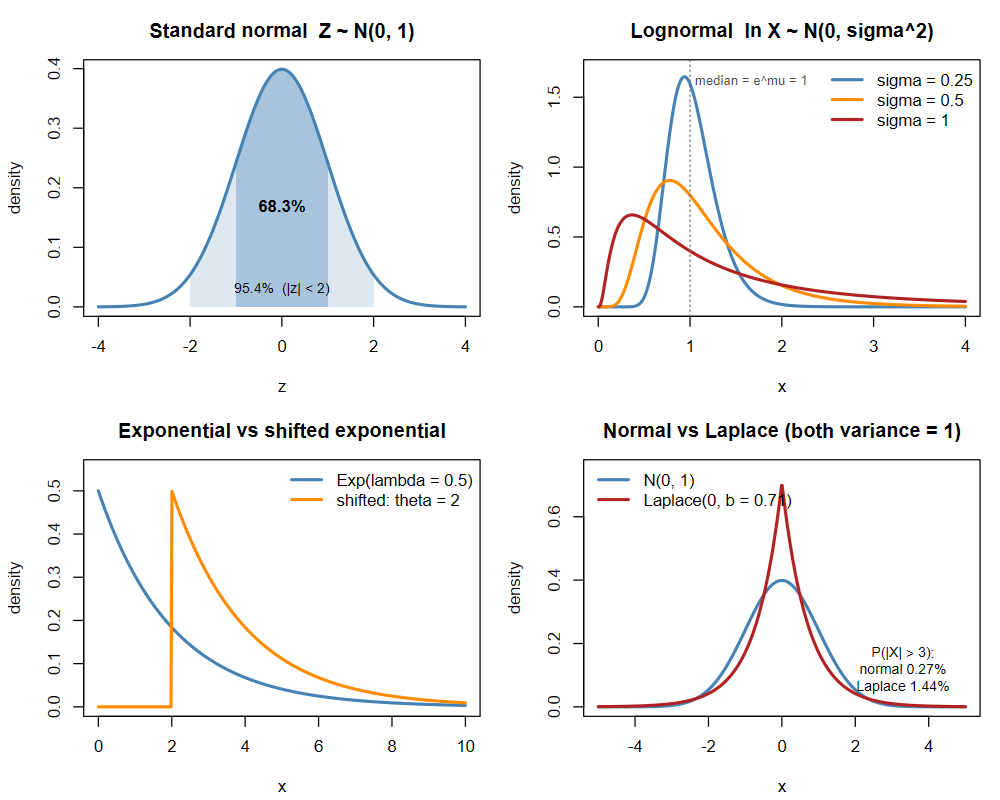

<!-- 第 5 章　常見機率模型　(編輯說明請看 docs/CONTENT.md) -->

## 離散分配

| 分配 | 情境 | $f(x)$ | $E(X)$ | $\operatorname{Var}(X)$ |
|---|---|---|---|---|
| 伯努利 $B(1, p)$ | 一次試驗，成功記 1 | $p^x (1-p)^{1-x}$ | $p$ | $p(1-p)$ |
| 二項 $B(n, p)$ | $n$ 次獨立試驗的成功次數 | $\binom{n}{x} p^x (1-p)^{n-x}$ | $np$ | $np(1-p)$ |
| 幾何 $G(p)$ | 第一次成功發生在第 $x$ 次 | $(1-p)^{x-1} p$ | $\dfrac{1}{p}$ | $\dfrac{1-p}{p^2}$ |
| 負二項 $NB(r, p)$ | 第 $r$ 次成功發生在第 $x$ 次 | $\binom{x-1}{r-1} p^r (1-p)^{x-r}$ | $\dfrac{r}{p}$ | $\dfrac{r(1-p)}{p^2}$ |
| 超幾何 | $N$ 個中有 $K$ 個成功，取出不放回 $n$ 個 | $\dfrac{\binom{K}{x}\binom{N-K}{n-x}}{\binom{N}{n}}$ | $\dfrac{nK}{N}$ | $n\dfrac{K}{N}\left(1-\dfrac{K}{N}\right)\dfrac{N-n}{N-1}$ |
| 卜瓦松 $P(\lambda)$ | 單位時間/空間內事件發生次數 | $\dfrac{e^{-\lambda}\lambda^x}{x!}$ | $\lambda$ | $\lambda$ |

前四種都建立在**成敗試驗**(伯努利試驗)上：每次試驗只有成功、失敗兩種結果，成功機率固定為 $p$，各次試驗互相獨立。差別在於「做幾次」與「數什麼」：

| 分配 | 試驗次數 | 隨機變數 |
|---|---|---|
| 伯努利 | 固定 1 次 | 成功次數(0 或 1) |
| 二項 | 固定 $n$ 次 | 成功次數 |
| 幾何 | 不固定，做到第 1 次成功為止 | 需要的試驗次數 |
| 負二項 | 不固定，做到累計 $r$ 次成功為止 | 需要的試驗次數 |

### 伯努利分配

進行**一次**成敗試驗，成功記 $X = 1$、失敗記 $X = 0$：

$$
f(x) = p, \quad P(X = 0) = 1 - p, \qquad E(X) = p, \qquad \operatorname{Var}(X) = p(1-p)
$$

例：一筆交易賺錢記 1、賠錢記 0；擲一枚硬幣出現正面記 1。

### 二項分配

進行 **$n$ 次相互獨立**的成敗試驗，$X$ = 成功的次數，$x = 0, 1, \ldots, n$：

$$
f(x) = \binom{n}{x} p^x (1-p)^{n-x}, \qquad E(X) = np, \qquad \operatorname{Var}(X) = np(1-p)
$$

$\binom{n}{x}$ 是「$n$ 次中哪 $x$ 次成功」的排法數，每一種排法的機率都是 $p^x (1-p)^{n-x}$。二項分配就是 $n$ 個獨立伯努利相加，所以 $E(X) = np$、$\operatorname{Var}(X) = np(1-p)$。

例：勝率 55% 的策略做 20 筆，賺錢筆數 $X \sim B(20,\ 0.55)$。

### 幾何分配

進行獨立的成敗試驗，**直到發生 1 次成功為止**，$X$ = 需要的試驗次數，$x = 1, 2, 3, \ldots$：前 $x - 1$ 次都失敗、第 $x$ 次成功，

$$
f(x) = (1-p)^{x-1} p, \qquad P(X > x) = (1-p)^x, \qquad E(X) = \frac{1}{p}
$$

例：勝率 55%，平均要做 $1/0.55 \approx 1.8$ 筆才會出現第一筆賺錢；連續 5 筆都賠錢的機率 $P(X > 5) = 0.45^5 \approx 1.8\%$。

> 有些教科書改用「第一次成功前的**失敗次數**」$Y = X - 1$ 定義幾何分配，$f(y) = (1-p)^y p$、$E(Y) = \frac{1-p}{p}$，看題目時要留意是哪一種。負二項分配也一樣。

### 負二項分配

進行獨立的成敗試驗，**直到累計發生 $r$ 次成功為止**，$X$ = 需要的試驗次數，$x = r, r+1, \ldots$：第 $x$ 次一定是成功，前 $x - 1$ 次中恰有 $r - 1$ 次成功，

$$
f(x) = \binom{x-1}{r-1} p^r (1-p)^{x-r}, \qquad E(X) = \frac{r}{p}, \qquad \operatorname{Var}(X) = \frac{r(1-p)}{p^2}
$$

$r = 1$ 時就是幾何分配；負二項 = $r$ 個獨立的幾何相加(每段「等到下一次成功」各是一個幾何)。

例：勝率 55%，要累積 10 筆賺錢的交易，平均需要 $10/0.55 \approx 18.2$ 筆。

### 超幾何分配

$N$ 個中有 $K$ 個「成功」，**不放回**抽出 $n$ 個，$X$ = 抽到的成功個數。因為不放回，各次抽取**不獨立**，這是它和二項分配的差別；變異數多乘的 $\frac{N-n}{N-1}$ 稱為**有限母體校正**。$N$ 很大($n/N < 5\%$)時，放不放回差不多，可用 $B(n,\ K/N)$ 近似。

例：50 檔成分股中有 10 檔是金融股，隨機挑 5 檔，抽到的金融股檔數。

### 卜瓦松分配

$X$ = 一段時間(或一塊空間)內事件發生的次數，$x = 0, 1, 2, \ldots$，$\lambda$ 為平均次數：

$$
f(x) = \frac{e^{-\lambda} \lambda^x}{x!}, \qquad E(X) = \operatorname{Var}(X) = \lambda
$$

卜瓦松分配來自**卜瓦松過程**(Poisson process)。計數過程 $\{N(t),\ t \ge 0\}$($N(t)$ = 到時間 $t$ 為止事件發生的次數)若滿足下列條件，稱為強度(發生率)$\lambda$ 的卜瓦松過程：

1. $N(0) = 0$：從 0 開始計數。
2. **獨立增量**：不重疊的時間區間內，發生的次數互相獨立。
3. **平穩增量**：任何長度為 $t$ 的區間，發生次數的分配只和長度有關，與起點無關。
4. **不會同時發生**：在很短的時間 $h$ 內，發生 1 次的機率約為 $\lambda h$，發生 2 次以上的機率小到可以忽略：

$$
P(N(h) = 1) = \lambda h + o(h), \qquad P(N(h) \ge 2) = o(h)
$$

由這些條件可以推得：長度 $t$ 的區間內發生次數 $N(s + t) - N(s) \sim P(\lambda t)$。直觀上，把時間 $t$ 切成 $n$ 小段，每段發生的機率 $\lambda t / n$，就是 $B(n,\ \lambda t / n)$；$n \to \infty$ 時的極限就是 $P(\lambda t)$(這也是下面卜瓦松近似二項的由來)。

例：某檔股票平均每分鐘成交 3 筆大單，5 分鐘內的大單筆數 $\sim P(15)$；一分鐘內完全沒有大單的機率 $e^{-3} \approx 5\%$。

## 連續分配

| 分配 | $f(x)$ | $E(X)$ | $\operatorname{Var}(X)$ |
|---|---|---|---|
| 均勻 $U(a, b)$ | $\dfrac{1}{b-a}$，$a \le x \le b$ | $\dfrac{a+b}{2}$ | $\dfrac{(b-a)^2}{12}$ |
| 指數 $\text{Exp}(\lambda)$ | $\lambda e^{-\lambda x}$，$x \ge 0$ | $\dfrac{1}{\lambda}$ | $\dfrac{1}{\lambda^2}$ |
| 平移指數 | $\lambda e^{-\lambda (x - \theta)}$，$x \ge \theta$ | $\theta + \dfrac{1}{\lambda}$ | $\dfrac{1}{\lambda^2}$ |
| 雙指數 $\text{Laplace}(\mu, b)$ | $\dfrac{1}{2b}\exp\left(-\dfrac{\lvert x-\mu \rvert}{b}\right)$ | $\mu$ | $2b^2$ |
| 伽瑪 $\Gamma(\alpha, \lambda)$ | $\dfrac{\lambda^\alpha x^{\alpha-1} e^{-\lambda x}}{\Gamma(\alpha)}$，$x > 0$ | $\dfrac{\alpha}{\lambda}$ | $\dfrac{\alpha}{\lambda^2}$ |
| 常態 $N(\mu, \sigma^2)$ | $\dfrac{1}{\sigma\sqrt{2\pi}}\exp\left[-\dfrac{(x-\mu)^2}{2\sigma^2}\right]$ | $\mu$ | $\sigma^2$ |
| 標準常態 $N(0, 1)$ | $\phi(z) = \dfrac{1}{\sqrt{2\pi}} e^{-z^2/2}$ | $0$ | $1$ |
| 對數常態 $LN(\mu, \sigma^2)$ | $\dfrac{1}{x\sigma\sqrt{2\pi}}\exp\left[-\dfrac{(\ln x-\mu)^2}{2\sigma^2}\right]$，$x > 0$ | $e^{\mu + \sigma^2/2}$ | $\left(e^{\sigma^2} - 1\right)e^{2\mu + \sigma^2}$ |

## 常態分配家族

### 常態分配

$X \sim N(\mu, \sigma^2)$ 的密度是以 $\mu$ 為中心、左右對稱的鐘形，$\sigma$ 越大越扁平。大量獨立的小因素加總起來會接近常態(第 6 章「中央極限定理」)，所以身高、量測誤差、樣本平均數都常用常態描述。**常態的線性組合仍是常態**：$aX + b \sim N(a\mu + b,\ a^2\sigma^2)$。

### 標準常態分配

平均數 0、標準差 1 的常態稱為**標準常態**，習慣用 $Z$ 表示，密度記為 $\phi(z)$、累積分配記為 $\Phi(z)$：

$$
Z \sim N(0, 1), \qquad \phi(z) = \frac{1}{\sqrt{2\pi}} e^{-z^2/2}, \qquad \Phi(z) = P(Z \le z) = \int_{-\infty}^{z} \phi(t)\,dt
$$

任何常態都可以**標準化**成標準常態，所以只要一張標準常態表就能算所有常態的機率：

$$
Z = \frac{X - \mu}{\sigma} \sim N(0, 1), \qquad P(a \le X \le b) = \Phi\left(\frac{b - \mu}{\sigma}\right) - \Phi\left(\frac{a - \mu}{\sigma}\right)
$$

- **對稱性**：$\Phi(-z) = 1 - \Phi(z)$，$P(|Z| \le z) = 2\Phi(z) - 1$。
- **68–95–99.7 法則**：落在 $\pm 1$、$\pm 2$、$\pm 3$ 個標準差內的機率約為 68.3%、95.4%、99.7%。

| $z$ | 1 | 1.28 | 1.645 | 1.96 | 2 | 2.326 | 2.576 | 3 |
|---|---|---|---|---|---|---|---|---|
| $\Phi(z)$ | 0.8413 | 0.8997 | 0.9500 | 0.9750 | 0.9772 | 0.9900 | 0.9950 | 0.9987 |

1.645、1.96、2.576 分別對應單尾 5%、雙尾 5%、雙尾 1%，是區間估計與假說檢定(第 8、9 章)最常用的臨界值。

### 對數常態分配

若 $\ln X \sim N(\mu, \sigma^2)$，則 $X$ 服從**對數常態分配**，也就是 $X = e^{Y}$、$Y \sim N(\mu, \sigma^2)$：

$$
f(x) = \frac{1}{x\sigma\sqrt{2\pi}}\exp\left[-\frac{(\ln x - \mu)^2}{2\sigma^2}\right],\ x > 0, \qquad
E(X) = e^{\mu + \sigma^2/2}, \qquad \text{中位數} = e^{\mu}, \qquad \text{眾數} = e^{\mu - \sigma^2}
$$

- **恆為正、右偏**：眾數 < 中位數 < 平均數，$\sigma$ 越大越偏(見下圖)。
- **相乘變相加**：獨立對數常態的乘積仍是對數常態，因為 $\ln(XY) = \ln X + \ln Y$。很多「一連串百分比變化相乘」的量(股價、所得、公司規模)都接近對數常態。
- **股價模型**：若連續複利報酬 $\ln(S_T / S_0) \sim N(\mu, \sigma^2)$，股價 $S_T$ 就是對數常態，永遠不會跌到負值(Black-Scholes 模型的假設)。例：$S_0 = 100$、一年的 $\ln(S_T/S_0) \sim N(0.08,\ 0.2^2)$，則股價中位數 $100e^{0.08} \approx 108.3$、平均數 $100e^{0.08 + 0.02} \approx 110.5$，一年後低於 100 的機率 $= P(Z < -0.4) \approx 34.5\%$。

## 指數分配家族

### 指數分配

$X \sim \text{Exp}(\lambda)$ 描述「等到下一次事件發生的時間」：$f(x) = \lambda e^{-\lambda x}$、$F(x) = 1 - e^{-\lambda x}$，$x \ge 0$。它有**無記憶性**：已經等了 $s$，再等超過 $t$ 的機率和剛開始等一樣，$P(X > s + t \mid X > s) = P(X > t)$。

### 平移指數分配

如果一定要先經過一段時間 $\theta$ 才可能發生(例如最短的處理時間、最小的損失金額)，就把指數分配整條往右移 $\theta$：

$$
X = \theta + Y,\ Y \sim \text{Exp}(\lambda) \qquad\Longrightarrow\qquad f(x) = \lambda e^{-\lambda(x - \theta)},\ x \ge \theta, \qquad E(X) = \theta + \frac{1}{\lambda}, \qquad \operatorname{Var}(X) = \frac{1}{\lambda^2}
$$

- 平移只改變位置，不改變形狀與變異數(第 3 章「變異數」$\operatorname{Var}(X + b) = \operatorname{Var}(X)$)。
- 超過 $\theta$ 之後仍有無記憶性；$\theta$ 是分配的「最小值」，估計時常用樣本最小值。
- 例：客服至少要 2 分鐘才能處理完一通電話，超過的部分平均 3 分鐘：$\theta = 2$、$\lambda = \tfrac{1}{3}$，平均處理時間 $2 + 3 = 5$ 分鐘，超過 8 分鐘的機率 $e^{-(8 - 2)/3} = e^{-2} \approx 13.5\%$。

### 雙指數分配(Laplace 分配)

以 $\mu$ 為中心，左右兩邊各接一個指數分配：

$$
f(x) = \frac{1}{2b}\exp\left(-\frac{\lvert x - \mu \rvert}{b}\right), \qquad E(X) = \mu, \qquad \operatorname{Var}(X) = 2b^2
$$

- **兩個獨立指數相減**：$Y_1, Y_2 \sim \text{Exp}(\lambda)$ 獨立，則 $Y_1 - Y_2 \sim \text{Laplace}(0,\ 1/\lambda)$。
- **峰尖尾厚**：與相同變異數的常態相比，中間更集中、兩端尾巴更厚(超額峰態 = 3，常態為 0)。例如變異數都是 1 時，$|X| > 3$ 的機率常態只有 0.27%，雙指數是 1.44%。
- **金融**：股票日報酬「平常小漲小跌、偶爾大漲大跌」的肥尾現象(第 1 章「四、分配形狀」)，雙指數往往比常態描述得更好。

## 重要性質

### 可加性

**獨立**且屬於同一家族的隨機變數相加，仍屬於同一家族(參數相加)：

| 相加的對象(互相獨立) | 結果 |
|---|---|
| $n$ 個伯努利 $B(1, p)$ | 二項 $B(n, p)$ |
| $B(n_1, p) + B(n_2, p)$(成功機率要相同) | $B(n_1 + n_2,\ p)$ |
| $r$ 個幾何 $G(p)$ | 負二項 $NB(r, p)$ |
| $NB(r_1, p) + NB(r_2, p)$ | $NB(r_1 + r_2,\ p)$ |
| $P(\lambda_1) + P(\lambda_2)$ | $P(\lambda_1 + \lambda_2)$ |
| $n$ 個指數 $\text{Exp}(\lambda)$ | 伽瑪 $\Gamma(n, \lambda)$ |
| $\Gamma(\alpha_1, \lambda) + \Gamma(\alpha_2, \lambda)$ | $\Gamma(\alpha_1 + \alpha_2,\ \lambda)$ |
| $N(\mu_1, \sigma_1^2) + N(\mu_2, \sigma_2^2)$ | $N(\mu_1 + \mu_2,\ \sigma_1^2 + \sigma_2^2)$ |

例：兩家券商每小時的委託筆數分別 $\sim P(4)$、$P(6)$ 且獨立，合計 $\sim P(10)$。注意：成功機率不同的二項相加**不是**二項；均勻分配相加也不再是均勻(兩顆骰子點數和是三角形)。

### 無記憶性

$$
P(X > s + t \mid X > s) = P(X > t)
$$

已經等了 $s$ 還沒發生，再等超過 $t$ 的機率和剛開始等一樣——過去等了多久不影響未來。**離散只有幾何分配、連續只有指數分配**具有這個性質。以幾何為例：

$$
P(X > s + t \mid X > s) = \frac{(1-p)^{s+t}}{(1-p)^{s}} = (1-p)^t = P(X > t)
$$

例：每次交易獨立、勝率固定時，已經連賠 5 筆，下一筆賺錢的機率仍是 55%，「連賠很多次，下一次應該要贏了」是**賭徒謬誤**。

> **直覺**：無法從過去的失敗中得到經驗或教訓，所以無論失敗幾次，只要還沒成功，永遠都和重新開始一樣。

### 對偶性

「固定次數數成功」和「固定成功數等次數」描述同一串試驗，所以機率可以互相換算。令 $X_n \sim B(n, p)$ 為前 $n$ 次的成功次數、$Y_r \sim NB(r, p)$ 為第 $r$ 次成功所需的次數：

$$
P(Y_r \le n) = P(X_n \ge r)
$$

「第 $r$ 次成功在第 $n$ 次以內發生」等同「前 $n$ 次至少成功 $r$ 次」。$r = 1$ 時：$P(Y_1 > n) = P(X_n = 0) = (1-p)^n$，就是幾何分配的尾機率。

連續的版本是卜瓦松過程：$N(t) \sim P(\lambda t)$ 為到時間 $t$ 的發生次數、$T_r \sim \Gamma(r, \lambda)$ 為第 $r$ 次發生的時間，

$$
P(T_r \le t) = P(N(t) \ge r), \qquad r = 1:\ P(T_1 > t) = P(N(t) = 0) = e^{-\lambda t}
$$

所以**卜瓦松過程兩次事件的間隔時間 $\sim \text{Exp}(\lambda)$**，等待第 $r$ 次的時間 $\sim \Gamma(r, \lambda)$。伽瑪的累積機率不好算時，可以改算卜瓦松的機率。

| 數「次數」(固定時間或試驗數) | 數「等待」(固定成功數) |
|---|---|
| 二項 $B(n, p)$ | 負二項 $NB(r, p)$(幾何是 $r = 1$) |
| 卜瓦松 $P(\lambda t)$ | 伽瑪 $\Gamma(r, \lambda)$(指數是 $r = 1$) |

## 近似

**卜瓦松近似**：$n$ 大、$p$ 小($n \ge 20$ 且 $p \le 0.05$)時

$$
B(n, p) \approx P(\lambda = np)
$$

**常態近似**：$np \ge 5$ 且 $n(1-p) \ge 5$ 時，$B(n, p) \approx N\left(np,\ np(1-p)\right)$，並做連續性校正：

$$
P(X \le k) \approx P\left(Z \le \frac{k + 0.5 - np}{\sqrt{np(1-p)}}\right)
$$

例：策略勝率 55%，做 20 筆，平均贏 11 筆，標準差 $\sqrt{20 \times 0.55 \times 0.45} \approx 2.22$ 筆；贏不到 8 筆的機率 $\approx P\left(Z \le \frac{7.5 - 11}{2.22}\right) \approx 5.8\%$。

## 不同機率模型之間的連結

各種機率模型並不是獨立的公式，而是透過「相加」「取極限」「變換」互相連結。抓住這些關係，就不必死背每個分配：

[[demo dist-map]]

| 連結方式 | 例子 | 意義 |
|---|---|---|
| **相加** | 伯努利 → 二項、幾何 → 負二項、指數 → 伽瑪、標準常態² → 卡方 | 重複同一件事，計算總次數或總時間 |
| **極限(近似)** | 二項 → 卜瓦松(稀有事件)、二項 / 卜瓦松 → 常態(次數很多)、超幾何 → 二項(母體很大) | 參數趨近極端時，複雜的分配可以用簡單的分配近似 |
| **變換** | 常態 → 標準常態(標準化)、常態 → 對數常態(取指數)、指數 → 平移指數(加常數)、兩個指數相減 → 雙指數、均勻 → 指數(−ln U / λ) | 對隨機變數做函數轉換，得到新的分配(第 3 章「隨機變數的函數仍是隨機變數」) |
| **離散與連續的對應** | 幾何 ↔ 指數(都有無記憶性)、卜瓦松 ↔ 指數(次數與間隔時間) | 同一個隨機過程，從「次數」或「時間」兩個角度描述 |

**主要差異**：

| | 離散型(二項、卜瓦松、幾何…) | 連續型(常態、指數、伽瑪…) |
|---|---|---|
| 描述的量 | 次數、個數 | 時間、金額、長度、報酬率 |
| 取值範圍 | 二項有上限 $n$；卜瓦松、幾何沒有上限 | 常態、雙指數在整條實數線；指數、伽瑪、對數常態只取正值；平移指數 $\ge \theta$ |
| 形狀 | 依參數可對稱或右偏 | 常態、雙指數對稱；指數、伽瑪、對數常態右偏 |
| 尾巴 | 卜瓦松、幾何的右尾以指數速度變小 | 雙指數的尾巴比常態厚；對數常態的右尾最長 |
