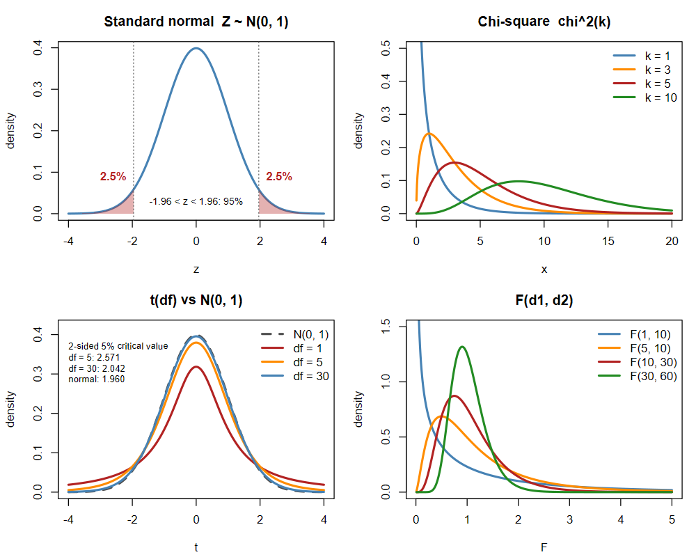

<!-- 第 6 章　抽樣方法與抽樣分配　(編輯說明請看 docs/CONTENT.md) -->

## 抽樣的基本觀念

- **母體**：想研究的全體對象；描述母體的數值(例如母體平均數 $\mu$、變異數 $\sigma^2$、比例 $p$)稱為**母體參數**，通常未知。
- **樣本**：從母體抽出、實際觀察的一部分；由樣本算出的數值(例如 $\bar{X}$、$S^2$、$\hat{p}$)稱為**統計量**。
- **統計推論**：用統計量去推估、檢定母體參數(第 7 章以後)。

### 隨機樣本

由母體抽出樣本大小為 $n$ 的一組**隨機樣本**，在抽出之前，每一個觀察值會是多少都不確定，所以可以視為 **$n$ 個隨機變數** $X_1, X_2, \ldots, X_n$。若

1. **獨立**：$X_1, \ldots, X_n$ 互相獨立(抽到誰不影響下一個抽到誰)；
2. **同分配**：每個 $X_i$ 的分配都和母體分配相同，

就稱它們**獨立同分配**(independent and identically distributed，**i.i.d.**)於母體分配：

$$
X_1, X_2, \ldots, X_n \overset{\text{i.i.d.}}{\sim} f(x), \qquad E(X_i) = \mu, \quad \operatorname{Var}(X_i) = \sigma^2, \quad i = 1, \ldots, n
$$

- 抽出之後得到的是一組數字 $x_1, x_2, \ldots, x_n$(小寫，第 3 章「定義」的記號)，稱為樣本的**觀察值**(實現值)。
- 從無限母體抽樣，或從有限母體**放回**抽樣，觀察值才會嚴格獨立；從有限母體不放回抽樣時，只要 $n/N$ 很小(常用 $< 5\%$)，仍可近似視為 i.i.d.。
- **統計量是樣本的函數**，例如 $\bar{X} = \frac{1}{n}\sum X_i$。因為 $X_i$ 是隨機變數，統計量也是隨機變數：換一組樣本，值就不同。統計量的機率分配稱為**抽樣分配**，這就是本章的主題。

例：台股某檔股票每天的報酬率看成來自同一個母體分配，隨機挑 $n = 50$ 天，就是 50 個 i.i.d. 的隨機變數；這 50 天的平均報酬 $\bar{X}$ 會隨挑到哪些天而變動。

## 抽樣方法

| 方法 | 做法 | 適用 |
|---|---|---|
| 簡單隨機抽樣 | 每個大小為 $n$ 的樣本被抽到的機率相同 | 母體同質、有完整名冊 |
| 分層隨機抽樣 | 依特性分層，每層內再隨機抽 | 層內同質、層間異質(例：依產業分層) |
| 群集抽樣 | 把母體分成許多群，隨機抽幾個群全部調查 | 群內異質、群間同質，節省成本 |
| 系統抽樣 | 隨機選起點後，每隔 $k$ 個抽一個 | 名冊沒有週期性，不可存再任意先驗規律 |

非隨機抽樣(便利、判斷、配額、雪球)無法計算抽樣誤差，不能做統計推論。**抽樣誤差**來自「只看了一部分」；**非抽樣誤差**來自涵蓋不全、無回應、量測偏差等，樣本再大也不會消失。

## 四大抽樣分配

由常態母體抽出的隨機樣本，以**標準常態**為基礎，可以導出卡方、$t$、$F$ 抽樣分配(下一節說明它們怎麼出現在樣本平均數、樣本變異數上)：

| 分配 | 由來 | 主要用途 |
|---|---|---|
| 標準常態 $N(0, 1)$ | $Z = \dfrac{\bar{X} - \mu}{\sigma/\sqrt{n}} \sim N(0, 1)$(母體為常態，見第 5 章「常態的線性組合」；或母體不是常態但為大樣本，由中央極限定理近似) | $\sigma$ 已知時 $\mu$ 的推論、大樣本的比例推論；也是另外三個分配的基礎 |
| 卡方 $\chi^2(k)$ | $k$ 個獨立標準常態的平方和；$\dfrac{(n-1)S^2}{\sigma^2} \sim \chi^2(n-1)$ | $\sigma^2$ 的推論、卡方檢定(第 12 章) |
| $t(k)$ | $\dfrac{Z}{\sqrt{\chi^2(k)/k}}$；$\dfrac{\bar{X} - \mu}{S/\sqrt{n}} \sim t(n-1)$ | $\sigma$ 未知時 $\mu$ 的推論、迴歸係數 |
| $F(k_1, k_2)$ | $\dfrac{\chi^2(k_1)/k_1}{\chi^2(k_2)/k_2}$；$\dfrac{S_1^2/\sigma_1^2}{S_2^2/\sigma_2^2} \sim F(n_1-1, n_2-1)$ | 兩變異數比較、ANOVA、迴歸整體檢定 |

- $t$ 分配對稱、比 $Z$ 尾巴厚，自由度 $\to \infty$ 時趨近 $N(0, 1)$；$t(k)^2 = F(1, k)$。
- $\chi^2(k)$ 平均 $k$、變異數 $2k$，右偏；$F$ 分配的倒數性質 $F_{1-\alpha}(k_1, k_2) = \dfrac{1}{F_\alpha(k_2, k_1)}$。

### 標準常態的尾點(臨界值)

**$z_\alpha$ 是右尾面積為 $\alpha$ 的點**：

$$
P(Z > z_\alpha) = \alpha \quad\Longleftrightarrow\quad \Phi(z_\alpha) = P(Z \le z_\alpha) = 1 - \alpha
$$

- **下標是右邊尾巴的面積**，不是左邊的累積機率。例如 $z_{0.05} = 1.645$：$Z$ 大於 1.645 的機率是 5%。
- **左尾用對稱**：標準常態以 0 為中心左右對稱，左尾面積 $\alpha$ 的點是 $-z_\alpha$，即 $P(Z < -z_\alpha) = \alpha$，也可寫成 $z_{1-\alpha} = -z_\alpha$。
- **雙尾各放一半**：兩邊合計 $\alpha$ 時，每邊 $\alpha/2$，用 $z_{\alpha/2}$，即 $P(-z_{\alpha/2} < Z < z_{\alpha/2}) = 1 - \alpha$。這就是信賴區間(第 8 章)與雙尾檢定(第 9 章)用的臨界值。

**查表**：常見的標準常態表列的是累積機率 $\Phi(z) = P(Z \le z)$，表的左欄是 $z$ 的整數與第一位小數、上列是第二位小數。要找 $z_\alpha$，就在**表身找 $1 - \alpha$**，再讀出對應的列與欄。例：$z_{0.025}$ 要找 $\Phi(z) = 0.975$，落在 1.9 那一列、0.06 那一欄，所以 $z_{0.025} = 1.96$。

| 右尾面積 $\alpha$ | 0.10 | 0.05 | 0.025 | 0.01 | 0.005 |
|---|---|---|---|---|---|
| $z_\alpha$ | 1.282 | 1.645 | 1.960 | 2.326 | 2.576 |
| 常見用途 | 雙尾 20%、單尾 10% | 單尾 5%、雙尾 10% | 雙尾 5% | 單尾 1%、雙尾 2% | 雙尾 1% |

$t$、$\chi^2$、$F$ 分配的臨界值也用同樣的記法，例如 $t_{\alpha,\,\nu}$、$\chi^2_{\alpha,\,\nu}$ 都是自由度 $\nu$ 時右尾面積為 $\alpha$ 的點。差別是 $\chi^2$、$F$ 不對稱，左尾的點不能取負號，要另外查 $\chi^2_{1-\alpha,\,\nu}$(右尾面積 $1 - \alpha$)。

## 常態母體下的抽樣分配

以下都假設由**常態母體**抽出隨機樣本 $X_1, \ldots, X_n \overset{\text{i.i.d.}}{\sim} N(\mu, \sigma^2)$，樣本平均數與樣本變異數為

$$
\bar{X} = \frac{1}{n}\sum_{i=1}^{n} X_i, \qquad S^2 = \frac{1}{n-1}\sum_{i=1}^{n}\left(X_i - \bar{X}\right)^2
$$

在常態母體下，以下結果**不論 $n$ 多小都精確成立**(不是近似)；母體不是常態時，要靠下一節「大樣本之統計量性質」的大樣本性質近似。

### 樣本平均數的抽樣分配(在 $\sigma^2$ 已知下)

獨立常態的線性組合仍是常態，$\bar{X} = \sum \frac{1}{n} X_i$ 是 $X_i$ 的線性組合，所以(證明見第 5 章「常態的線性組合」)

$$
\bar{X} \sim N\left(\mu,\ \frac{\sigma^2}{n}\right), \qquad Z = \frac{\bar{X} - \mu}{\sigma/\sqrt{n}} \sim N(0, 1)
$$

- $E(\bar{X}) = \mu$：樣本平均數平均而言等於母體平均數(不偏)。
- $\sigma_{\bar{X}} = \dfrac{\sigma}{\sqrt{n}}$ 稱為**標準誤**：樣本數變成 4 倍，標準誤減半。
- 有限母體不放回抽樣且 $n/N > 5\%$ 時，要乘上有限母體校正：$\sigma_{\bar{X}} = \dfrac{\sigma}{\sqrt{n}}\sqrt{\dfrac{N-n}{N-1}}$。

例：某檔股票日報酬 $\sim N(0.05\%,\ (1.5\%)^2)$，隨機取 25 天，平均日報酬 $\bar{X} \sim N\left(0.05\%,\ (0.3\%)^2\right)$；25 天平均為負的機率 $P\left(Z < \frac{0 - 0.05}{0.3}\right) = \Phi(-0.17) \approx 43\%$。

### 樣本平均數的抽樣分配(在 $\sigma^2$ 未知下)

實務上 $\sigma^2$ 通常未知，只能用樣本標準差 $S$ 代替 $\sigma$。多了「估計 $\sigma$」的不確定性，分配就從標準常態變成 **$t$ 分配**：

$$
T = \frac{\bar{X} - \mu}{S/\sqrt{n}} \sim t(n - 1)
$$

這個結果來自常態母體的兩個性質：

$$
\frac{(n-1)S^2}{\sigma^2} \sim \chi^2(n-1), \qquad \bar{X} \text{ 與 } S^2 \text{ 互相獨立}
$$

所以 $T = \dfrac{(\bar{X} - \mu)/(\sigma/\sqrt{n})}{\sqrt{\dfrac{(n-1)S^2}{\sigma^2} \Big/ (n-1)}} = \dfrac{Z}{\sqrt{\chi^2(n-1)/(n-1)}}$，正好是 $t$ 分配的定義。

- 自由度 $n - 1$：$S^2$ 的 $n$ 個離差 $X_i - \bar{X}$ 加總一定是 0，只有 $n - 1$ 個可以自由變動。
- $t$ 分配比標準常態的尾巴厚，$n$ 小時差異明顯(例如 $n = 5$ 時雙尾 5% 的臨界值是 2.776，常態是 1.96)；$n$ 很大時 $S \approx \sigma$，$t$ 分配趨近標準常態。
- 同樣的條件下，樣本變異數本身的分配就是上面的卡方：$\dfrac{(n-1)S^2}{\sigma^2} \sim \chi^2(n-1)$，用來推論 $\sigma^2$(第 7、9 章)。這個結果非常依賴常態假設，母體不是常態時，即使是大樣本也不一定準。

### 兩獨立母體下的抽樣分配

兩個獨立的常態母體 $N(\mu_1, \sigma_1^2)$、$N(\mu_2, \sigma_2^2)$，各抽 $n_1$、$n_2$ 個樣本。兩個獨立常態相減仍是常態，平均數相減、變異數相加(第 5 章「常態的線性組合」)：

$$
\bar{X}_1 - \bar{X}_2 \sim N\left(\mu_1 - \mu_2,\ \frac{\sigma_1^2}{n_1} + \frac{\sigma_2^2}{n_2}\right)
$$

| 情況 | 抽樣分配 |
|---|---|
| $\sigma_1^2$、$\sigma_2^2$ 已知 | $Z = \dfrac{(\bar{X}_1 - \bar{X}_2) - (\mu_1 - \mu_2)}{\sqrt{\sigma_1^2/n_1 + \sigma_2^2/n_2}} \sim N(0, 1)$ |
| 未知但相等($\sigma_1^2 = \sigma_2^2$) | $T = \dfrac{(\bar{X}_1 - \bar{X}_2) - (\mu_1 - \mu_2)}{S_p\sqrt{1/n_1 + 1/n_2}} \sim t(n_1 + n_2 - 2)$，合併變異數 $S_p^2 = \dfrac{(n_1 - 1)S_1^2 + (n_2 - 1)S_2^2}{n_1 + n_2 - 2}$ |
| 未知且不相等 | $T = \dfrac{(\bar{X}_1 - \bar{X}_2) - (\mu_1 - \mu_2)}{\sqrt{S_1^2/n_1 + S_2^2/n_2}} \overset{\text{approx}}{\sim} t(\nu)$，$\nu = \dfrac{\left(S_1^2/n_1 + S_2^2/n_2\right)^2}{\dfrac{(S_1^2/n_1)^2}{n_1 - 1} + \dfrac{(S_2^2/n_2)^2}{n_2 - 1}}$(Welch 近似) |
| 兩變異數的比 | $F = \dfrac{S_1^2/\sigma_1^2}{S_2^2/\sigma_2^2} \sim F(n_1 - 1,\ n_2 - 1)$ |

- 合併變異數 $S_p^2$ 是兩組樣本變異數依自由度加權的平均(第 4 章「兩組資料合併後的變異數」)。
- 變異數是否相等，可先用 $F$ 分配檢定(第 9 章)；不確定時，用 Welch 近似比較保險。
- 兩組樣本**不獨立**時(例如同一批股票在政策前後的報酬)，要改用成對差 $D_i = X_{1i} - X_{2i}$，回到單一母體的情況：$\dfrac{\bar{D} - \mu_D}{S_D/\sqrt{n}} \sim t(n-1)$。

例：比較兩檔 ETF 的平均月報酬，各取 36 個月，假設月報酬為常態、變異數未知且不相等，$\bar{X}_1 - \bar{X}_2$ 標準化後近似 Welch 的 $t$ 分配。

## 大樣本之統計量性質

樣本數 $n$ 越來越大時，統計量會呈現一些好用的性質(稱為**大樣本性質**或漸近性質)：樣本平均數會越來越接近母體平均數(大數法則)，而且它的分配會越來越接近常態(中央極限定理)。

### 弱大數法則與強大數法則

設 $X_1, X_2, \ldots$ 為 i.i.d.，平均數 $\mu$ 存在，$\bar{X}_n = \frac{1}{n}\sum_{i=1}^{n} X_i$。

**弱大數法則**(Weak Law of Large Numbers，WLLN)：$\bar{X}_n$ **機率收斂**於 $\mu$，

$$
\lim_{n \to \infty} P\left(\left|\bar{X}_n - \mu\right| > \varepsilon\right) = 0, \quad \text{對任意 } \varepsilon > 0, \qquad \text{記為 } \bar{X}_n \xrightarrow{p} \mu
$$

母體期望值 $\mu$ 和變異數 $\sigma^2$ 皆有限且存在，可以用柴比雪夫不等式(第 3 章「Chebyshev 不等式」)直接證明：

$$
P\left(\left|\bar{X}_n - \mu\right| \ge \varepsilon\right) \le \frac{\operatorname{Var}(\bar{X}_n)}{\varepsilon^2} = \frac{\sigma^2}{n\varepsilon^2} \xrightarrow{n \to \infty} 0
$$

 > 意思是：只要 $n$ 夠大，$\bar{X}_n$ 和 $\mu$ 差距超過 $\varepsilon$ 的**機率**可以小到任意程度，即當 $n \to \infty$ 時，$\bar{X}_n$ 和 $\mu$ 要多接近就有多接近的機率為1。

**強大數法則**(Strong Law of Large Numbers，SLLN)：$\bar{X}_n$ **幾乎必然收斂**於 $\mu$，

$$
P\left(\lim_{n \to \infty} \bar{X}_n = \mu\right) = 1, \qquad \text{記為 } \bar{X}_n \xrightarrow{a.s.} \mu
$$

 > 意思是：把樣本一個一個加進來，得到一整串 $\bar{X}_1, \bar{X}_2, \ldots$，這**一整串**最後一定會收斂到 $\mu$(不收斂的情況機率為 0)。

| | 弱大數法則 | 強大數法則 |
|---|---|---|
| 收斂方式 | 機率收斂：對每個夠大的 $n$，偏離的機率很小 | 幾乎必然收斂：整條樣本路徑最終會停在 $\mu$ |
| 強弱 | 較弱 | 較強(強大數法則成立 $\Rightarrow$ 弱大數法則成立) |
| 直觀 | 「某一個很大的 $n$ 時，$\bar{X}_n$ 很可能接近 $\mu$」 | 「持續增加樣本，$\bar{X}_n$ 偏離 $\mu$ 的情況終究只會發生有限次」 |

大數法則說明了「用樣本平均數估計母體平均數」為什麼合理，也是頻率學派機率(第 2 章「Kolmogorov 公設化機率」：重複很多次，相對次數趨近機率)與蒙地卡羅模擬的理論基礎。前面擲骰子、擲硬幣的模擬，次數越多越接近理論值，就是大數法則。

### 中央極限定理

設 $X_1, X_2, \ldots$ 為 i.i.d.，平均數 $\mu$、變異數 $\sigma^2$ 有限，則不論母體是什麼分配，

$$
Z_n = \frac{\bar{X}_n - \mu}{\sigma/\sqrt{n}} \xrightarrow{d} N(0, 1), \qquad \text{也就是 } \lim_{n \to \infty} P(Z_n \le z) = \Phi(z)\ \text{對所有 } z
$$

這種收斂稱為**分配收斂**($\xrightarrow{d}$)。大數法則告訴我們 $\bar{X}$ 會跑到哪裡($\mu$)，中央極限定理告訴我們它在 $\mu$ 附近怎麼分布(常態、寬度 $\sigma/\sqrt{n}$)；它也解釋了為什麼很多「許多小因素加總」的量會接近常態。

**收斂有多快，取決於母體分配**。定理只保證 $n \to \infty$ 時成立，實際需要多少樣本，主要看母體的**偏態**：$\bar{X}$ 的偏態係數等於母體偏態 $\div \sqrt{n}$，所以母體越對稱，越快接近常態；母體偏態加倍，需要的樣本數大約變成 4 倍。下表是 $P(|Z_n| \le 1.96)$ 實際的機率(常態近似下應為 95%，上下尾各 2.5%)：

| 母體分配 | 偏態 | $n = 5$ | $n = 30$ | $n = 100$ |
|---|---|---|---|---|
| 均勻 $U(0, 1)$ | 0 | 95.2%(上 2.4%、下 2.4%) | 95.0%(上 2.5%、下 2.5%) | 95.0%(上 2.5%、下 2.5%) |
| 指數 $\text{Exp}(\lambda)$ | 2 | 95.6%(上 4.3%、下 0.0%) | 95.2%(上 3.4%、下 1.4%) | 95.1%(上 3.0%、下 1.9%) |

註：指數為精確計算(樣本平均數服從伽瑪分配)，均勻為 40 萬次模擬。

- **對稱的母體收斂得很快**：均勻分配 $n = 5$ 就和常態幾乎一樣(常態母體則任何 $n$ 都是常態)，**不需要 $n \ge 30$**。
- **偏態的母體收斂得慢**：看兩尾就知道——總和接近 95%，但右尾偏多、左尾偏少，用常態算單尾機率會錯。指數分配到 $n = 30$ 兩尾是 3.4% 對 1.4%，到 $n = 100$ 仍是 3.0% 對 1.9%；偏態更大的母體(例如所得、股票報酬)要到好幾百筆才夠。
- **變異數不存在時不成立**：例如柯西分配(兩個獨立標準常態相除，見第 5 章「柯西分配」)，樣本平均數的分配和單一觀察值一模一樣，樣本再大也不會接近常態。

所以「$n \ge 30$」不是中央極限定理的一部分，只是對「不太偏的母體」常用的折衷；對稱的母體用不到 30，偏態大的母體 30 又不夠。

### 樣本比例的抽樣分配

樣本比例 $\hat{p}$ 是 $n$ 個伯努利(成功記 1、失敗記 0)的平均數，母體不是常態，要靠中央極限定理近似：

$$
E(\hat{p}) = p, \qquad \sigma_{\hat{p}} = \sqrt{\frac{p(1-p)}{n}}, \qquad np \ge 5 \text{ 且 } n(1-p) \ge 5 \text{ 時 } \hat{p} \overset{\text{approx}}{\sim} N\left(p,\ \frac{p(1-p)}{n}\right)
$$

同理，母體不是常態時，只要 $n$ 夠大，$\bar{X} \overset{\text{approx}}{\sim} N\left(\mu,\ \dfrac{\sigma^2}{n}\right)$，下方擲骰子模擬可親眼看到。

### 其他大樣本性質

- **一致性**：$n \to \infty$ 時統計量機率收斂到它要估計的參數，稱為一致估計式。由大數法則，$\bar{X} \xrightarrow{p} \mu$、$\hat{p} \xrightarrow{p} p$、$S^2 \xrightarrow{p} \sigma^2$。
- **以 $S$ 取代 $\sigma$**：大樣本時 $S$ 很接近 $\sigma$，所以 $\dfrac{\bar{X} - \mu}{S/\sqrt{n}}$ 也近似 $N(0, 1)$，不需要母體為常態；這也是 $t$ 分配自由度很大時趨近標準常態的原因。

### 多大才算「大樣本」？

$n \ge 30$ 是實務上常用的規則，但它只是經驗法則，不是定理。依管中閔(2004)《統計學：觀念與方法》(二版)的觀點，**依應用的問題本身，應有不同的「大樣本」準則**：近似要多準，取決於母體分配的形狀、要近似的統計量，以及所需的精確度。

| 情況 | 需要的樣本數 |
|---|---|
| 母體接近常態、對稱 | 很小的 $n$ 就夠，甚至 $n < 30$ |
| 母體明顯偏態或厚尾(例如所得、股票報酬、保險理賠) | 可能要好幾百筆，$n = 30$ 往往不夠 |
| 樣本比例 $\hat{p}$ | 看 $np \ge 5$ 且 $n(1-p) \ge 5$：$p = 0.5$ 時 $n = 10$ 即可；$p = 0.01$ 時需要 $n \ge 500$ |
| 樣本變異數 $S^2$、相關係數等 | 收斂到常態比 $\bar{X}$ 慢，需要更大的樣本 |

例：用 30 天的日報酬估計一檔股票的平均報酬，標準誤 $\sigma / \sqrt{30}$ 往往比平均報酬本身大好幾倍(日報酬的標準差約 1～2%，平均每天只有 0.03～0.05%)，而且日報酬有厚尾(第 5 章「雙指數分配」)，常態近似也不夠準——在這個問題裡，30 筆完全稱不上「大樣本」。

